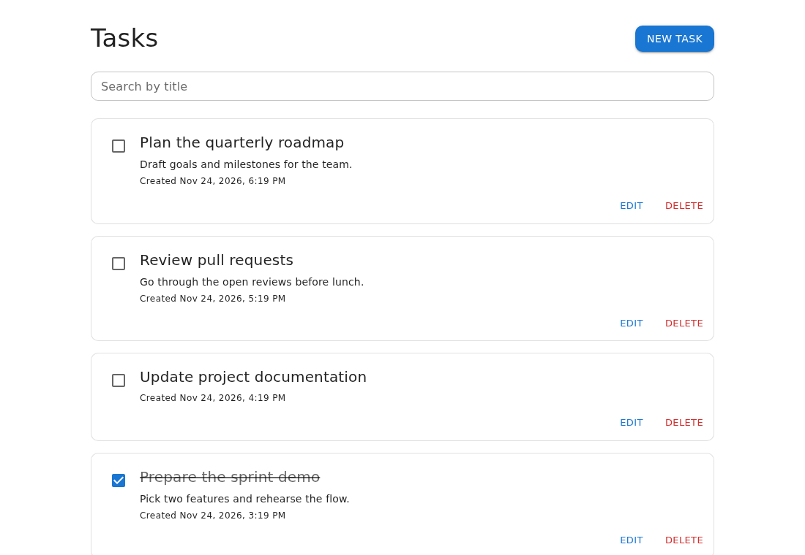
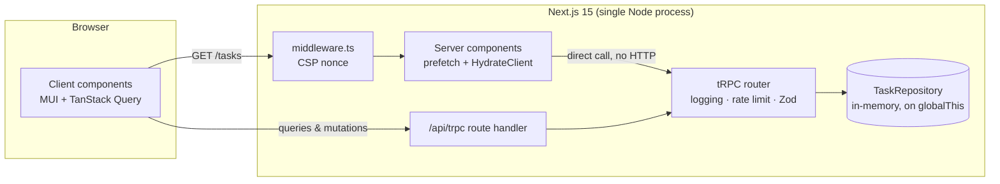
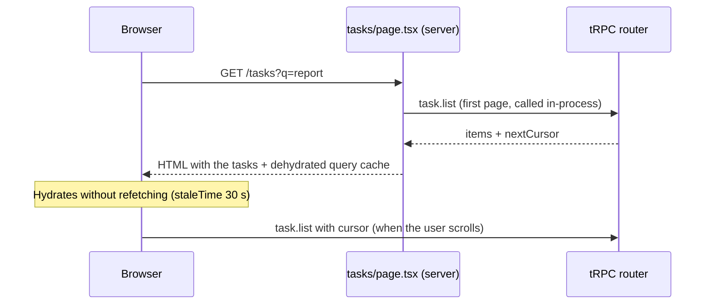

# Task Manager — Next.js 15 + tRPC

[](https://github.com/VanLMC/task-manager-nextjs-trpc/actions/workflows/ci.yml)

A small task manager with an in-memory backend exposed through tRPC. The task list is rendered on the server, then the client takes over with TanStack Query for infinite scrolling, search and optimistic updates.

<picture>
  <source media="(prefers-color-scheme: dark)" srcset=".github/assets/task-list-dark.png">
  
</picture>

## Quick start

Requires Node.js 24 (see `.nvmrc`).

```bash
npm ci
npm run dev          # http://localhost:3000
```

Production build, or with Docker:

```bash
npm run build && npm start

docker build -t task-manager .
docker run -p 3000:3000 task-manager
```

The store starts with 30 fictional tasks so scrolling and search can be tried right away. All data lives in memory and resets when the server restarts.

| Environment variable | Default | Purpose |
|---|---|---|
| `SEED_TASKS` | `true` | Set to `false` to start with an empty list |
| `RATE_LIMIT_PER_MINUTE` | `30` | Mutations allowed per client IP per minute |

### Scripts

| Script | What it does |
|---|---|
| `npm run check` | Lint (Biome), type-check and unit tests |
| `npm run test:coverage` | Unit and component tests with coverage thresholds |
| `npm run test:e2e` | Playwright tests against the production build (run `npm run build` first) |

## Features

| Requirement | Where |
|---|---|
| Task model: `id`, `title`, `description?`, `createdAt` | `src/features/tasks/task.schema.ts` |
| Create, list, update and delete through tRPC | `src/server/routers/task.router.ts` |
| No task without a title; meaningful errors (`BAD_REQUEST`, `NOT_FOUND`, `CONFLICT`) | Shared Zod schema + `errorFormatter` in `src/server/trpc.ts` |
| List page pre-loaded with SSR | `src/app/tasks/page.tsx` |
| Delete from the list with feedback | `useDeleteTask` — optimistic removal, **Undo**, rollback on failure |
| Create/edit form with hooks and validation | `useTaskForm` + `TaskForm`, `CreateTaskForm`, `EditTaskForm` |
| Loading, success and failure states | Pending buttons, snackbar messages, inline field errors, error boundary, 404 page |
| **Bonus:** infinite scroll | `useInView` (IntersectionObserver) + cursor pagination, with a "Load more" fallback |
| **Bonus:** documentation | This file and comments on non-obvious decisions |

Beyond the brief: mark tasks as completed, search by title kept in the URL (`/tasks?q=…`), dark mode that follows the OS, undo on delete, conflict detection on edits, rate limiting, structured logs, a nonce-based Content Security Policy and a Docker image.

### Field names

The case describes the model in Portuguese. The code uses English names, like the rest of the project:

| Case | Code | Type |
|---|---|---|
| `id` | `id` | `string` (UUID, generated by the server) |
| `titulo` | `title` | `string`, required, trimmed, up to 120 characters |
| `descricao` | `description` | `string`, optional, up to 1000 characters |
| `dataCriacao` | `createdAt` | `Date` (sent as a `Date` thanks to superjson) |
| — | `completed`, `updatedAt` | `boolean`, `Date` |

## Architecture





```
src/
  app/                  routes: /tasks, /tasks/new, /tasks/[id]/edit, /api/trpc, /api/health
  features/tasks/       schema, components and hooks for the task feature
  server/               tRPC init, routers, middlewares, repository, security
  shared/               feedback snackbar, error messages, theme and layout
  trpc/                 client provider, server proxy and query client
  middleware.ts         per-request Content Security Policy
e2e/                    Playwright tests
```

## API

All procedures live under `/api/trpc` and use superjson.

| Procedure | Input | Result | Errors |
|---|---|---|---|
| `task.list` | `{ query?, cursor?, limit? = 10 }` | `{ items, nextCursor }` | `BAD_REQUEST` |
| `task.byId` | `{ id }` | task | `NOT_FOUND` |
| `task.create` | `{ title, description? }` | task | `BAD_REQUEST` with `fieldErrors`, `PRECONDITION_FAILED` (500 tasks) |
| `task.update` | `{ id, expectedUpdatedAt, title?, description?, completed? }` | task | `NOT_FOUND`, `CONFLICT`, `BAD_REQUEST` |
| `task.delete` | `{ id }` | `{ id }` | `NOT_FOUND` |
| `task.restore` | `{ id }` (within 10 s of the delete) | task | `NOT_FOUND` |

Every mutation can also return `TOO_MANY_REQUESTS`. Every response carries an `x-request-id` header that matches the server log line.

## Key decisions

- **Next.js 15, not 16.** The case asks for v15; this uses the latest 15.x release.
- **`@trpc/tanstack-react-query`.** The integration tRPC v11 recommends. It works with plain TanStack Query APIs and supports server prefetching and hydration.
- **SSR without an extra HTTP hop.** The list page calls the router directly on the server and hands the result to the client cache. With JavaScript disabled the tasks are still in the HTML (covered by an end-to-end test).
- **No `loading.tsx` on these routes.** A route-level loading boundary streams the response, which sends status 200 before the page runs. Without it, a missing task returns a real **404**, and the SSR content is not hidden behind a skeleton.
- **Keyset pagination.** The cursor is the `createdAt` and `id` of the last task, not an offset or an index. Creating or deleting tasks while scrolling never skips or repeats items, even when the cursor task itself is deleted.
- **One store per process.** The repository lives on `globalThis`, so the API route and server components share it and dev hot reloads keep the data. It sits behind a `TaskRepository` interface, so a database version would replace one file.
- **Undo instead of a confirm dialog.** Deleting is immediate; the server keeps the task for 10 seconds so **Undo** can restore it in its original position.
- **Optimistic concurrency.** Updates send the `updatedAt` they were based on. If the task changed in the meantime, the server answers `CONFLICT` and the form offers to reload the latest version instead of silently overwriting it.
- **Dates in a fixed time zone.** Server and browser format dates the same way, so hydration never mismatches.
- **MUI.** Accessible components with an official App Router integration, so no custom CSS was needed.

## From theory to practice

How the trade-offs discussed in the theory part are handled in this code:

| Concern | How this project handles it |
|---|---|
| tRPC type safety is compile-time only; procedures are public HTTP endpoints | Zod validates every input on the server; mutations are rate-limited per client IP |
| Error responses must not leak internals | `errorFormatter` returns field errors, and replaces unexpected errors with a generic message (details go to the server log) |
| Browser-side security | Nonce-based CSP with `strict-dynamic`, plus `X-Frame-Options`, `nosniff`, `Referrer-Policy`, `Permissions-Policy` and HSTS |
| Observability | One JSON log line per call with a request id, duration and error code |
| Scaling beyond one process | The storage interface plus a shared test suite: a Postgres implementation would have to pass the same tests |
| SSR vs CSR | First page on the server, later pages and interactions on the client, with no refetch after hydration |
| Concurrent clients | Optimistic concurrency on updates |

## Testing

| Level | Tools | Covers |
|---|---|---|
| Repository contract | Vitest + fast-check | A suite any `TaskRepository` must pass, including **property-based tests**: for any random history of creates and deletes, paging returns every task exactly once and in order |
| API | Vitest + `createCaller` | Validation, `NOT_FOUND`, `CONFLICT`, store limit, rate limit, logging, error masking |
| Components and hooks | Testing Library | Forms, list, toggle, delete with undo, conflicts, search, scrolling. They talk to the **real router in-process** (no HTTP mocks) |
| End to end | Playwright + axe | SSR with JavaScript disabled, no refetch on load, infinite scroll, search, full CRUD with undo, real 404, security headers, accessibility in light and dark mode |

CI runs lint, type-check, unit tests with coverage thresholds, the production build, the end-to-end tests, a Docker build and a gitleaks scan of the full history.

## Known limitations

- Data is in memory: it is lost on restart and not shared between processes or serverless instances. The app must run as a single Node process.
- There is no authentication; every visitor sees the same list.
- The rate limiter trusts the last `X-Forwarded-For` entry, which is correct behind exactly one proxy.

## Next steps

- **Live sync across tabs** with a tRPC subscription (server-sent events), so other tabs update when a task changes.
- **Pull-request workflow** with required CI checks and a `v1.0.0` release tag.
- A Postgres `TaskRepository` that passes the existing contract suite.
- Authentication with a task list per user.
- An OpenAPI description generated from the router, Lighthouse checks in CI and mutation testing.
